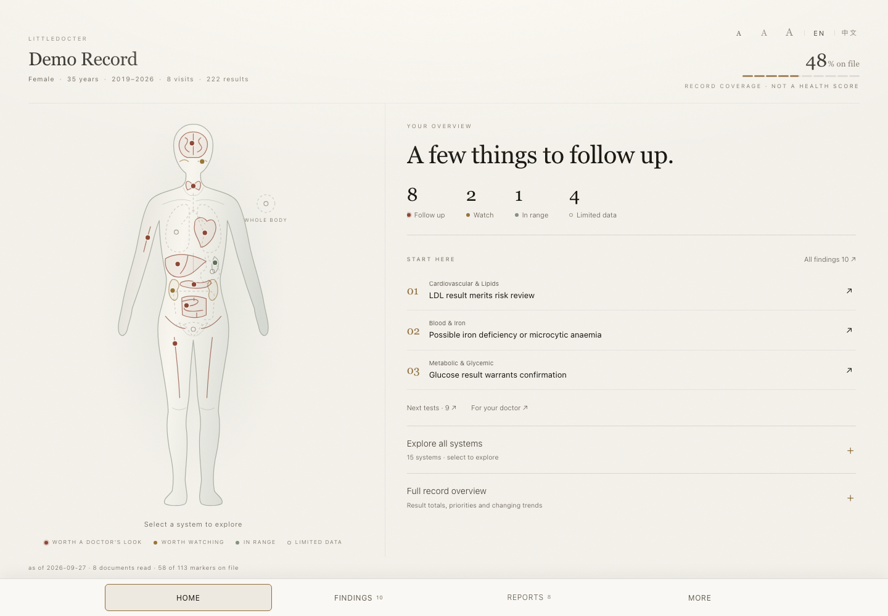
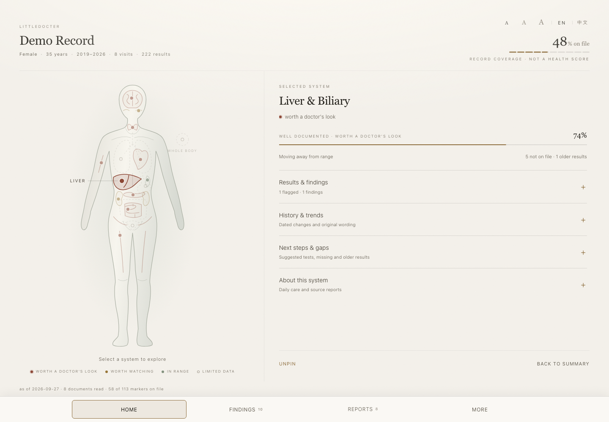
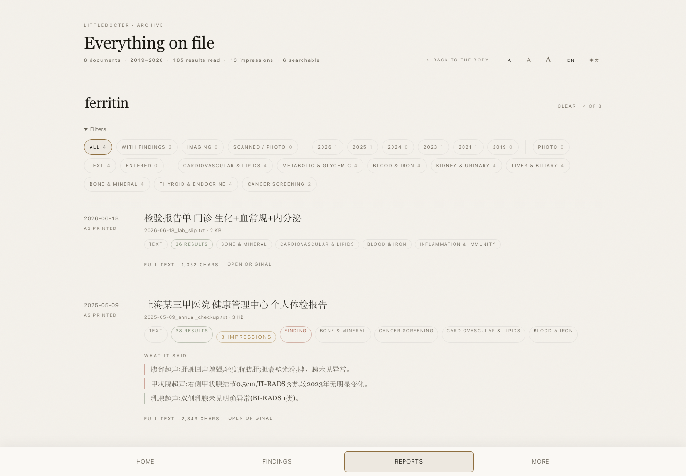
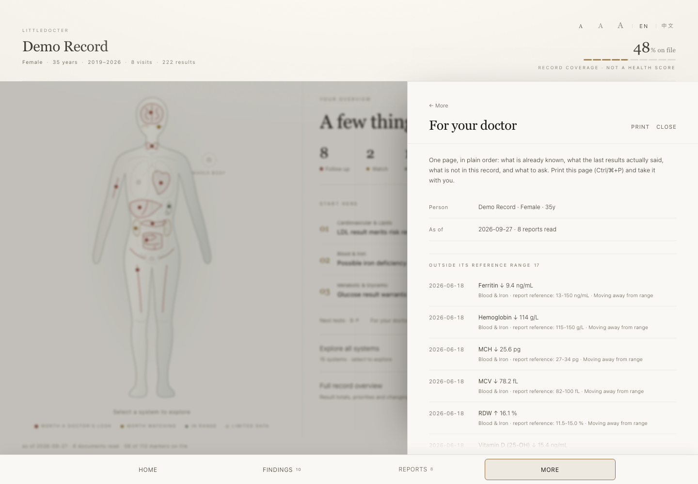

# littledocter

**Your medical reports → one readable record → a better-prepared doctor visit.**

Local HTML pages · English / 中文 · 15 body systems · Searchable source reports

An adult record-review tool. **Not a diagnosis, treatment plan, or emergency service.** Screening reminders are off by default. [Clinical scope and evidence →](docs/CLINICAL_SCOPE.md)



*All screenshots use the bundled demo record. No personal records are shown.*

## Try it in a minute

From the project folder, with Python 3.10 or newer:

```sh
python3 -m venv .venv
source .venv/bin/activate          # Windows: .venv\Scripts\activate
python -m pip install -r requirements.txt
python littledocter.py demo --no-vision --open
```

The homepage opens in your browser. You can also double-click **`site/index.html`**. No server or build step is needed.

The demo uses sample reports. It writes `data/demo/` and regenerates `site/`; it leaves your personal profile and parsed data alone. Scan previews need Pillow; scan transcription needs a separately configured OCR helper.

## Four buttons. One clear path.

| Button | What to do there |
| --- | --- |
| **Home** | Scan the overview. Select a body system or a priority finding. Expand details when needed. |
| **Findings** | Read the observation, its supporting results and dates. Follow a source link to check the report. |
| **Reports** | Search by word, marker, date or system. Expand full text or open the original file. |
| **More** | Open **Next tests**, **Trends**, **For your doctor**, or **About**. Use **← More** to return. |

The bottom bar stays visible. **Home** returns to the overview; **Close** or **Esc** dismisses a sheet. **A A A** changes text size; **EN / 中文** switches language. Both settings are remembered. On desktop, hovering previews a system; clicking pins it. On a phone, tap to open it.

## See the details when you need them

| Explore a system | Check the original evidence |
| --- | --- |
|  |  |
| Four expandable sections keep the overview short while retaining results, history, gaps and sources. | Search the archive, read the full text and compare extracted values with the original. |

**Prepare for a visit:** More → For your doctor → **Print**. The sheet includes recorded conditions, medicines, dated results and questions to discuss. Paper length depends on your record.



## Add your own records

1. **Create a blank profile:** `python littledocter.py init`.
2. **Edit `data/profile.yaml`:** enter your name, sex and birth date when known. Add conditions and medicines; leave unknown fields empty. Existing profiles are never overwritten by `init`.
3. **Copy reports into `reports/`:** nested folders are supported. Include dates in the documents or filenames, such as `2026-09-01_lab.txt`.
4. **Build your record:** `python littledocter.py run --no-vision --open`.
5. **Open `site/index.html`:** inspect Findings, verify the sources, then check **More → About** for reading limitations and warnings.

After adding or correcting a report, run the same command and refresh the page.

### Files and optional readers

| Input | What is needed |
| --- | --- |
| TXT / Markdown, CSV / TSV, YAML / JSON, DOCX | PyYAML is the only required library. See [sample records](sample_reports/) for structured formats. |
| Text-based PDFs | `python -m pip install pymupdf` |
| Image previews | `python -m pip install pillow` — supported image formats depend on installed decoders. |
| Scanned PDFs / photos → text | An OCR helper configured through `ANALYZE_IMAGE_SCRIPT`; omit `--no-vision` only after reviewing that helper's data handling. |
| DICOM | Optional `pydicom`; pixel previews also need suitable image/numeric dependencies. |

**`--no-vision` skips OCR, not available previews.** A listed scan is not necessarily a successfully read scan. If no measurements or examinations can be read, the command stops without replacing existing parsed data.

## Understand the result

- **Outside range** means a recorded value is outside an interpretable reference interval; it does not identify the cause.
- **Context only** means automatic grading is inappropriate or the input needs review.
- **Not in this record** means data are missing here—not that you have never had the test or must now have it.
- **Older result** is distinct from a current measurement.
- **Coverage %** describes the available record checklist. It is not a health score or diagnostic confidence.
- **Derived** identifies a calculation from available inputs.

Known conditions can change a system's display to “under care”; this does not confirm that every result in that system is being treated. The app has no complete emergency assessment. [Read the clinical review before relying on its interpretation.](docs/CLINICAL_SCOPE.md)

## Privacy and sharing

With `--no-vision`, report processing stays local. The generated pages make no external requests. An optional OCR helper may use an external service—its behavior is separate from the HTML pages.

`reports/`, generated `data/`, and `site/` are ignored by Git. **The generated site contains health data and may contain scan previews.** Share it only intentionally. `--with-originals` additionally copies source documents into the site. Without that flag, original-file links point to your local report folder and may not work for someone else.

## Useful commands

```sh
python littledocter.py run --no-vision             # Read → analyse → render
python littledocter.py render                      # Rebuild pages from saved analysis
python littledocter.py docs                        # List imported documents and warnings
python littledocter.py search ferritin             # Search report text
python littledocter.py trend liver                 # Inspect one system's history
python littledocter.py run --today 2024-01-01 --no-vision
```

Paths work before or after the command:

```sh
python littledocter.py run --reports ~/scans --profile ~/profile.yaml \
  --data /tmp/my-record --site /tmp/my-record/site --no-vision
```

Historical replay filters dated results. Undated profile information, such as medicines or a manually entered age, remains as supplied; use a profile appropriate to the replay date.

<details>
<summary><strong>Troubleshooting</strong></summary>

| Problem | Next step |
| --- | --- |
| `No module named yaml` | Activate the environment and run `python -m pip install -r requirements.txt`. |
| PDF or scan not read | Install the relevant optional reader; inspect warnings in the terminal or More → About. Scans need OCR. |
| No readable results | Check file format and dates. Try the bundled demo to verify installation. |
| Original link does not open | Keep the original report folder in place, or deliberately rebuild with `--with-originals`. |
| Changes are not visible | Re-run `run` after changing records, or `render` after changing templates, then refresh. |
| Screening list is absent | Expected by default. Optional regional configuration is explained in [docs/CLINICAL_SCOPE.md](docs/CLINICAL_SCOPE.md). |

</details>

<details>
<summary><strong>Development and verification</strong></summary>

```text
reports/ → src/ingest.py → measurements.json
         → src/analyze.py → analysis.json
         → src/render.py + web/ → site/*.html
```

Knowledge definitions live in `knowledge/`; page templates live in `web/`. Read [AGENTS.md](AGENTS.md) before changing either.

```sh
python littledocter.py check
python -m unittest discover -s tests -v
python -m pip install pyflakes playwright
python -m playwright install chromium webkit
python -m pyflakes src/*.py littledocter.py tools/*.py tests/*.py
python littledocter.py demo --no-vision
python tools/verify_figure.py
python tools/verify_ui.py
python tools/verify_ui.py --browser webkit
```

Browser checks cover Chromium and WebKit, both languages and seven viewport sizes. Automated checks verify software behavior, not clinical validity. See [clinical scope](docs/CLINICAL_SCOPE.md).

</details>

### Local file safety

Saved JSON and HTML files are replaced atomically, with owner-only permissions on macOS. Concurrent CLI writers to the same data/site folders are rejected. Use separate input and output folders; report symlinks are skipped and asset symlinks are rejected. Missing originals or invalid page data stop rendering before existing files are changed. A whole run is not one filesystem transaction: after an interruption, rerun the command to finish updating both pages and assets.

Build the source-only ZIP outside the project with `python tools/package.py`. The package excludes personal records, generated pages, caches, virtual environments and Git history. A SHA-256 file is written alongside it.
